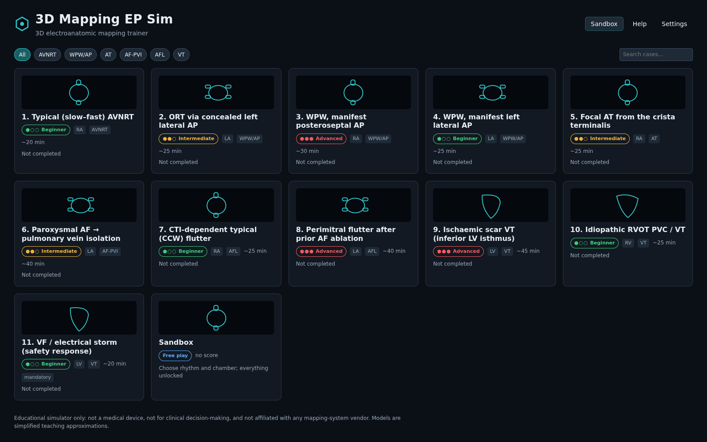
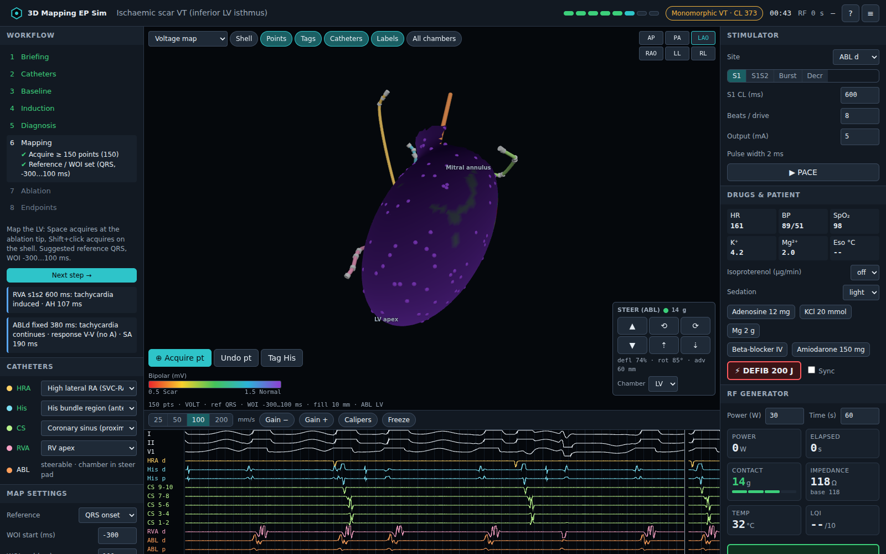

# 3D Mapping EP Sim

3D Mapping EP Sim is an interactive, browser-based **3D electroanatomic mapping simulator** for training in cardiac electrophysiology (EP). It is a static site (plain HTML, CSS and vanilla ES modules) that uses three.js and needs no build step.

> **Educational disclaimer.** This is a teaching simulator only. It is **not a medical device**, it is not validated for clinical use, and it must not guide patient care. It is **not affiliated with, endorsed by or derived from any mapping-system vendor**. All names, UI and models are original. The physiology is a simplified teaching approximation.

## Screenshots





## Features
- **Case library.** 11 encoded cases plus a Sandbox, each with a difficulty badge, chamber and estimated time:
  1. Typical AVNRT
  2. ORT via a concealed left lateral AP
  3. WPW, posteroseptal
  4. WPW, left lateral
  5. Focal AT from the crista terminalis
  6. Paroxysmal AF / PVI
  7. CTI-dependent flutter
  8. Perimitral flutter after prior ablation
  9. Ischaemic scar VT
  10. RVOT PVC/VT
  11. VF / electrical storm
- **Enforced workflow.** The steps are briefing (vignette, schematic 12-lead ECG, quiz), catheter placement, baseline intervals with calipers, induction, diagnostic maneuvers and diagnosis commit, mapping, ablation, endpoint tests, and debrief. RF is gated until a diagnosis is committed (except in the VF case).
- **3D viewport.** Procedural RA/LA/RV/LV shells (about 14k nodes) with landmarks.
  - **Maps:** LAT and bipolar voltage maps built from acquired points, using the reference channel, window of interest (WOI), fill radius and colour bar. A live propagation view is also available.
  - **Point acquisition:** Space at the catheter tip, or Shift+click on the shell.
  - **Views:** AP/PA/LAO/RAO/LL/RL presets, orbit and zoom.
  - **Ablation catheter:** steerable (deflection, torque, advance) with a contact-force arrow.
- **Propagation engine.** An event-driven graph cellular automaton with restitution, decremental AV-nodal pathways (dual physiology, Wenckebach), accessory pathways and a His–Purkinje system. Mechanisms include:
  - macro-reentry (CTI, perimitral, scar isthmus)
  - automatic and triggered foci
  - AF drivers in the pulmonary veins
  - VF
- **EGM panel.** A sweeping display of I, II, V1, HRA, His d/p, CS 9-10…1-2, RVA and ABL d/p (plus a PV loop in AF), synthesised from the live activation. It has sweep speed, gain, freeze and calipers.
- **Stimulator.** S1, S1S2(S3), burst and decremental pacing, with entrainment analysis (PPI, PPI−TCL, VAV/VAAV, SA). Also offers a His-refractory PVC, para-Hisian pacing, isoproterenol, adenosine and storm drugs.
- **RF generator.**
  - **Delivery:** power, duration and contact force settings, with live impedance, temperature and a lesion quality index (LQI). Lesion tags are tiered weak/good/strong/excessive.
  - **Lesion effects:** lesions block conduction. Gaps in a line still conduct. Oedema recovers after the waiting period, and weak lesions on pathways can reconnect.
  - **Safety model:** AV block near the His, impedance rise, steam pop and tamponade, excessive contact force, phrenic nerve, oesophageal temperature, PV stenosis. The generator auto-stops on red alerts.
  - **Defibrillation:** synchronised or unsynchronised.
- **Scoring and debrief.**
  - **Quizzes:** checkpoint quizzes per phase, plus 3 tiered hints per step (tier 3 shows a ghost target).
  - **Rubric:** the 100-point rubric (domains A–H) with safety deductions and grade bands.
  - **Debrief screen:** shows a timeline, a final map snapshot, the "expert path" and a JSON export.
- **Accessibility.** Dark theme built from the spec tokens, a colorblind-safe palette, keyboard shortcuts (press `?` or F1 for help), ARIA roles and live regions, focus trapping in modals and reduced-motion support.

## Running locally
```bash
cd "3D mapping EP sim"
python3 -m http.server 8000
# open http://localhost:8000/
```
You need an internet connection for three.js, which is loaded from `cdn.jsdelivr.net` (pinned to `three@0.160.0`) through an import map. All paths are relative, so the folder can be published as-is on GitHub Pages.

Useful URL parameters:
- `?case=<id>` opens a case directly, for example `?case=avnrt`.
- `?autotest=<id>|all` runs the scripted smoke test.

## Project structure
```
index.html              app shell, import map
css/tokens.css          design tokens (docs/03 §1.2, colorblind palette §7.2)
css/styles.css          layout and components
js/main.js              app: library, case flow, render loop, keyboard, debrief
js/workflow.js          step gating, maneuvers, diagnosis, endpoint tests
js/scoring.js           100-point rubric + safety deductions
js/autotest.js          scripted end-to-end smoke test
js/cases/cases.js       11 cases + sandbox (vignettes, engine config, quizzes, hints, endpoints)
js/engine/              geometry (SDF chambers, surface nets), propagation, scenario,
                        mechanisms, sim, catheters, egm, stimulator, ablation, mapping,
                        endpoints, targets
js/ui/                  viewport3d, egmPanel, panels, modals, alerts, keymap
js/util/heap.js         event heap
tests/                  headless harness (autotest.sh, run.sh, engine tests)
docs/                   research spec, clinical curriculum, UX/UI design
```

## Tests
With a local server on port 8765 and a headless Chromium:
- `tests/autotest.sh all` runs every case end to end. Each case is placed, measured, induced, mapped, ablated at its target, put through its endpoint tests and scored, and the script prints one `RESULT` line per case.
- `tests/st.py` and `tests/script_test.html` drive the engine directly.

## Known limitations
- The anatomy is procedural, made of smooth ellipsoid/capsule unions and not patient-derived. The wall is modelled as a single surface layer with a nominal thickness.
- EGMs and the surface ECG are synthesised kernels, not biophysical. The 12-lead is shown as a text and schematic description, and only I, II, V1 and aVF are computed.
- Pace mapping is a distance-based score. There is no fluoroscopy view, so the time domain uses simulated procedure time as a proxy.
- Some mechanism onsets are rule-based: reentry is seeded when the stimulation criteria are met, not purely emergent.

## Credits
Content and behaviour follow the project specifications in `docs/`:
- `01_research_spec.md` (physiology and engine model)
- `02_clinical_cases_curriculum.md` (cases, workflow, rubric, pearls)
- `03_ux_ui_design.md` (visual identity, layout, interaction, accessibility)

3D rendering uses [three.js](https://threejs.org) (MIT).

## License
MIT © chatchaine. See [LICENSE](LICENSE).
